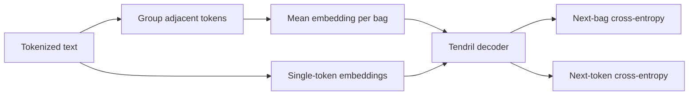
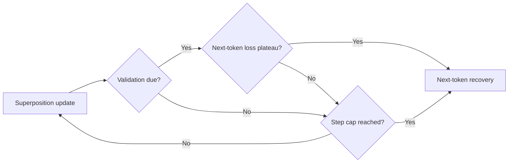
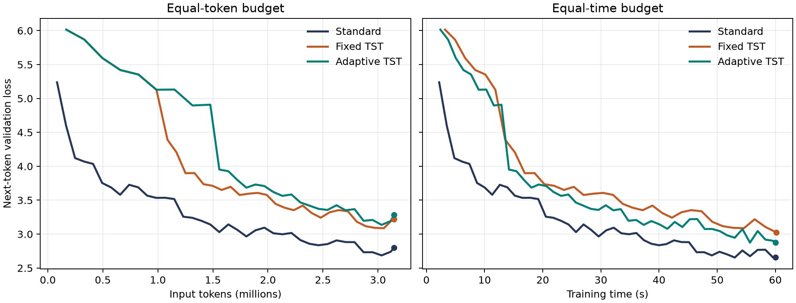

# TrainFlux

TrainFlux is a research codebase for measuring training efficiency in small language models. Its first study evaluates whether token superposition can increase the amount of data processed during pretraining while preserving next-token prediction quality.

## Adaptive Token Superposition

Token Superposition Training (TST) groups adjacent tokens into bags. The dense Tendril decoder averages the embeddings within each bag and predicts the next bag using the mean cross-entropy of its target tokens. With bag size $s$, each training step reads $s$ times as many input tokens at the same transformer sequence length. Recovery resumes ordinary next-token prediction with the same model and optimizer state.



| Mode | Training schedule |
| --- | --- |
| Standard | Next-token prediction throughout |
| Fixed TST | Bag prediction until a configured optimizer step, then next-token recovery |
| Adaptive TST | Bag prediction until next-token validation loss plateaus or the configured step cap is reached |



## Benchmark

Six runs on [Modal](https://modal.com/) used a 19.8M-parameter Tendril model, a 35,000-story TinyStories training subset, BF16, and seed 42. Loss is next-token validation cross-entropy in nats.

| Mode | Time at 3.15M tokens | Loss at 3.15M tokens ↓ | Tokens in 60 s | Loss at 60 s ↓ |
| --- | ---: | ---: | ---: | ---: |
| Standard | 72.10 s | **2.7989** | 3.72M | **2.6552** |
| Fixed TST | 62.04 s | 3.2170 | 3.30M | 3.0261 |
| Adaptive TST | **52.21 s** | 3.2827 | **4.46M** | 2.8742 |

Adaptive TST processed **19.8% more tokens in 60 seconds**. Standard training achieved lower validation loss at both endpoints. The adaptive runs entered recovery at the 360-step cap because the plateau criterion was never met. These single-seed runs used separate L4 sandboxes, and the two standard runs varied from 43.6k to 62.0k tokens/s.



[Full report](benchmarks/results/tinystories-l4/REPORT.md) · [Run data](benchmarks/results/tinystories-l4) · [Benchmark protocol](benchmarks/README.md)

## Reproduce on Modal

Use Python 3.11 or later and an authenticated Modal workspace.

```bash
python -m pip install -r requirements.txt "modal==1.6.4" "matplotlib>=3.8"
python -m benchmarks.prepare_tinystories datasets/tst-tinystories
python -m benchmarks.modal_tst runs/tst-modal
python -m benchmarks.report_tst runs/tst-modal runs/tst-report
```

Run `python -m pytest -q` to verify the training and checkpoint paths. The [benchmark protocol](benchmarks/README.md) documents the training settings.

## License

[Apache-2.0](LICENSE).
