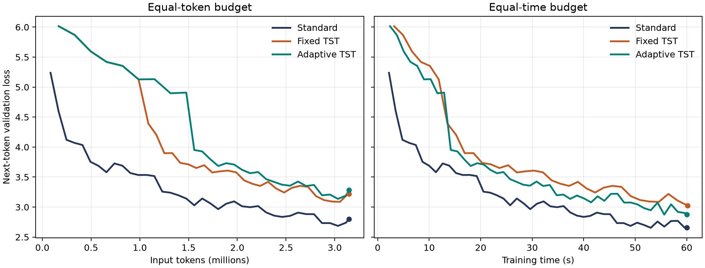
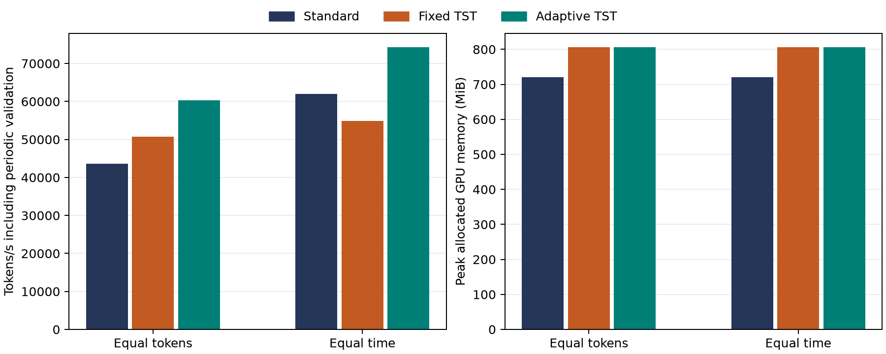

# TrainFlux Adaptive TST benchmark

Tendril has 19,798,528 parameters. The runs used NVIDIA L4, PyTorch 2.10.0+cu128, and seed 42.

The TinyStories subset contains 35,000 training stories and 1,000 validation stories. The 4,096-token BPE tokenizer was trained on the training stories. The training shard contains 7,884,773 tokens. Validation uses next-token cross-entropy on a fixed slice of 65,536 target tokens. Perplexity is the exponential of this loss.

## Results

### Equal-token budget

| Mode | Tokens | Training (s) | Val loss | Perplexity | Tokens/s | Step tokens/s | Peak MiB (allocated / reserved) | Estimated GPU cost (USD) | Recovery step |
| --- | ---: | ---: | ---: | ---: | ---: | ---: | ---: | ---: | ---: |
| Standard | 3,145,728 | 72.10 | 2.7989 | 16.43 | 43,632 | 54,386 | 721 / 784 | $0.0162 | — |
| Fixed TST | 3,145,728 | 62.04 | 3.2170 | 24.95 | 50,704 | 63,226 | 806 / 856 | $0.0140 | 250 |
| Adaptive TST | 3,145,728 | 52.21 | 3.2827 | 26.65 | 60,246 | 74,502 | 806 / 856 | $0.0118 | 360 |

- Fixed TST changed validation loss by +0.4181 nats and throughput by +16.2% relative to standard training.
  Within the same sandbox, optimizer-step throughput was 94,219 tokens/s during superposition and 54,563 tokens/s during recovery.
- Adaptive TST changed validation loss by +0.4839 nats and throughput by +38.1% relative to standard training.
  Within the same sandbox, optimizer-step throughput was 104,675 tokens/s during superposition and 59,395 tokens/s during recovery.
- Adaptive TST began recovery at optimizer step 360 (at the configured step cap).

### Equal-time budget

| Mode | Tokens | Training (s) | Val loss | Perplexity | Tokens/s | Step tokens/s | Peak MiB (allocated / reserved) | Estimated GPU cost (USD) | Recovery step |
| --- | ---: | ---: | ---: | ---: | ---: | ---: | ---: | ---: | ---: |
| Standard | 3,721,216 | 60.02 | 2.6552 | 14.23 | 62,002 | 75,654 | 721 / 784 | $0.0135 | — |
| Fixed TST | 3,299,328 | 60.13 | 3.0261 | 20.62 | 54,866 | 68,257 | 806 / 856 | $0.0135 | 250 |
| Adaptive TST | 4,456,448 | 60.01 | 2.8742 | 17.71 | 74,259 | 90,363 | 806 / 856 | $0.0135 | 360 |

- Fixed TST changed validation loss by +0.3709 nats and throughput by -11.5% relative to standard training.
  Within the same sandbox, optimizer-step throughput was 101,884 tokens/s during superposition and 59,430 tokens/s during recovery.
- Adaptive TST changed validation loss by +0.2190 nats and throughput by +19.8% relative to standard training.
  Within the same sandbox, optimizer-step throughput was 137,922 tokens/s during superposition and 77,199 tokens/s during recovery.
- Adaptive TST began recovery at optimizer step 360 (at the configured step cap).

## Experimental protocol

- The equal-token target is 3,145,728 input tokens. The equal-time target is 60 seconds. Timed trials stop at a completed optimizer step and may slightly exceed the target.
- Training time covers the training loop, including data loading and periodic validation. The run data records an additional endpoint validation separately when needed. Step throughput uses optimizer step time.
- All modes share the model, initialization seed, tokenizer, input order, AdamW settings, and validation sample. A TST step consumes twice as many input tokens. Equal-token trials can therefore use different numbers of optimizer steps.
- Fixed TST enters recovery at step 250. Adaptive TST can switch after 100 steps and three consecutive validation checks without a loss improvement of at least 0.05. The step cap is 360. Steps are zero-indexed.
- Estimated GPU cost for completed trials is $0.0826, calculated from process duration and the L4 list rate.
- Each setting uses a single seed. The results describe this model and training budget.
- The adaptive policy and reported comparison share a validation slice. No independent test split was evaluated.
- Standard training achieved 43,632 and 62,002 tokens/s across two L4 sandboxes. Run duration and sandbox variability limit interpretation of throughput differences.

[TinyStories](https://huggingface.co/datasets/roneneldan/TinyStories) · [Modal pricing](https://modal.com/pricing)
